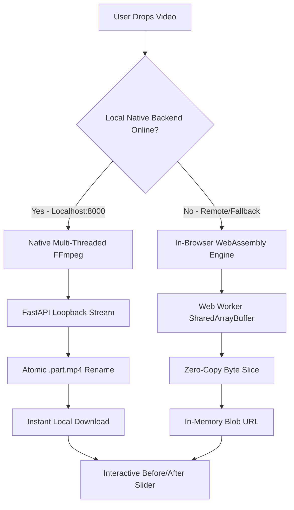

# 🥊 Tuckin — Same video. Way less weight.

> **Privacy-first, zero-BS video compression with a hybrid engine.**  
> Native multi-threaded FFmpeg on your local desktop, seamless WebAssembly fallback in the browser.  
> *No sign-up. No tracking. No limits.*

```
   (\_/)  
   ( •_•)   < "Your 2 GB video is looking a little chunky."
  / >📦      "Let's put it on the treadmill."
```

---

## 🏃 What is Tuckin?

Most online video compressors are shady: they force a 500 MB upload cap, upload your personal footage to an unknown cloud server, watermark your render, and make you wait in an arbitrary queue.

**Tuckin is built differently.** It is an inhouse, privacy-first compression studio designed for humans who want tiny videos without compromising quality or privacy.

- ⚡ **Zero Cloud Voyeurism**: 100% private. Files are processed locally on your machine.
- 🚀 **Blazing Multi-Threaded Speed**: 1.8+ GB movie files compress in **~1.5 minutes** on your local CPU (saturating all 12+ logical cores) instead of stalling for hours.
- 🎛️ **The Squeeze Dial**: Simple 3-stop analog dial — no confusing bitrates, codecs, or maths.
- 🔄 **Smart Hybrid Engine**:
  - **Local Desktop**: Routes directly to multi-threaded native FFmpeg on `localhost`.
  - **Browser/Mobile**: Gracefully falls back to client-side WebAssembly (`@ffmpeg/ffmpeg`) in a dedicated Web Worker with Screen Wake Lock.
- 🎧 **No More Silent 5.1 Audio**: Intelligent downmix from 5.1/7.1 AC3 surround sound to crisp 2-channel stereo AAC — dialogue is actually audible!
- 📱 **Symmetric Long-Side Scaling**: Portrait (1080x1920) and Landscape (1920x1080) clips are treated as equals — no weird vertical squishing.
- 🎞️ **Before & After Wipe Slider**: Interactive scrubber to spot the difference before you save.

---

## 🎚️ The Squeeze Dial

| Mode | Stop | Target Savings | Ideal For |
|---|---|---|---|
| **Light Jog** | `0.60` | **~40% less weight** | Casual shares, quick Discord uploads, keeping full 1080p sharpness |
| **Gym Regular** | `0.45` | **~55% less weight** | The sweet spot. Crisp 720p, rich colours, massive storage drop |
| **Marathon** | `0.30` | **~70% less weight** | Massive movies, email attachments, tight mobile storage caps |

---

## 🏗️ Architecture & Engine Routing



### Under the Hood
1. **Container Integrity**: Output MP4s always feature the `ftyp` signature with `moov` atom faststart (`-movflags +faststart`) for instant web streaming and playback on iOS, Android, QuickTime, VLC, and Windows Media Player.
2. **Modulo-2 Odd Dimensions**: Non-standard phone crops (e.g., 1281x721) are automatically rounded to even boundaries (`-2`) to guarantee hardware encoder compatibility.
3. **Safety Margin Bitrate Control**: Target mode incorporates an 8% safety margin with an automated post-check pass to guarantee files never overshoot requested ceilings.
4. **Daemon-Safe Execution**: Backend FFmpeg subprocesses run with `-nostdin` and `stdin=subprocess.DEVNULL` to prevent background worker deadlocks.

---

## 🚀 Quick Start (Local Setup)

### 1. Prerequisites
- **Python 3.10+**
- **Node.js 18+** & npm
- **FFmpeg & ffprobe** installed and available in your system `PATH`

### 2. Backend Setup (Native Multi-Threaded Engine)
```bash
# Navigate to the backend directory
cd app/backend

# Install dependencies
pip install -r requirements.txt

# Start the local FastAPI server
python -m uvicorn main:app --host 127.0.0.1 --port 8000 --reload
```
*Backend runs on `http://127.0.0.1:8000` (Health check: `GET /health`).*

### 3. Frontend Setup (Neo-Brutalist Web UI)
```bash
# Open a new terminal and navigate to the frontend directory
cd app/frontend

# Install dependencies
npm install

# Start Vite dev server
npm run dev
```
*Frontend runs on `http://localhost:5173`.*

---

## 🌐 Production Architecture (Vercel + Render + UptimeRobot)

Tuckin is architected to deploy seamlessly on modern cloud infrastructure with zero cold starts:
- **Frontend**: [Vercel](https://vercel.com) (Edge CDN with pre-configured SharedArrayBuffer headers for client-side WASM)
- **Backend**: [Render](https://render.com) / [Railway](https://railway.com) (Docker container with native multi-threaded FFmpeg & SQLite3)
- **Keep-Alive**: Configurable HTTP health check pinging `/health` to maintain zero-cold-start performance

---

## 🧪 Verification & Testing

Tuckin includes an automated end-to-end QA verification suite covering 30 real-world edge cases (surround sound downmix, 10-bit HEVC, 1.8 GB movie streaming, odd dimensions, and memory safety):

```bash
# Run backend pytest suite
python -m pytest app/backend/tests -v

# Run frontend Vitest suite
cd app/frontend && npm test
```

---

## 🔒 Privacy Guarantee

- **No Cookies**: Zero analytics cookies or tracking pixels.
- **No Telemetry**: No third-party network calls whatsoever.
- **Ephemeral Storage**: Uploaded files and temporary encode buffers are automatically deleted immediately after download or upon TTL expiration (30 minutes).

---

## 📄 License

MIT © 2026 Tuckin Contributors. Feel free to fork, hack, and squeeze!
